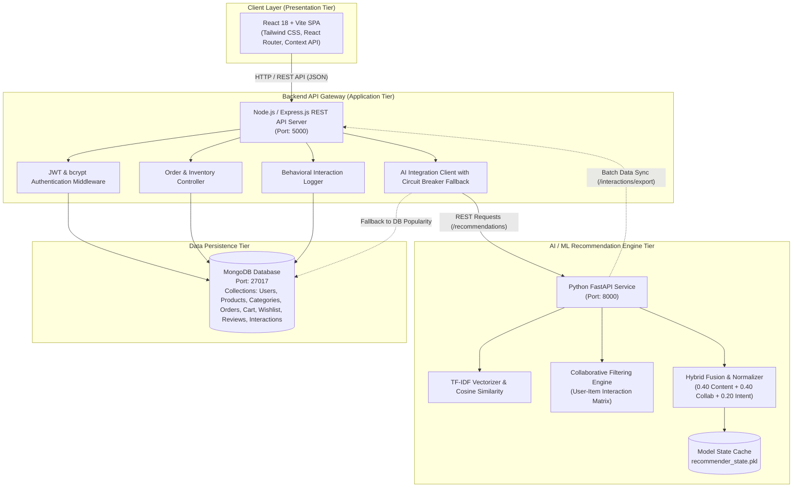
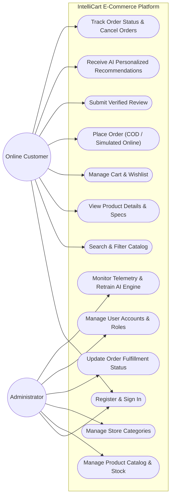
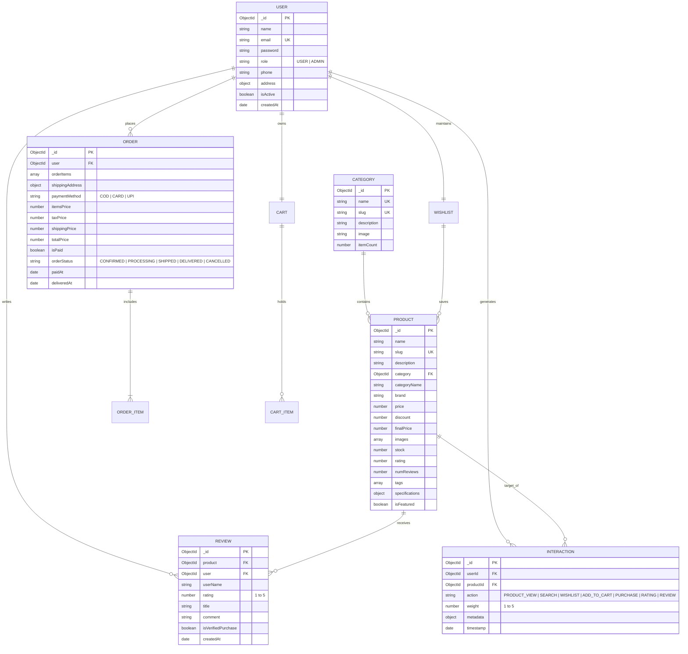
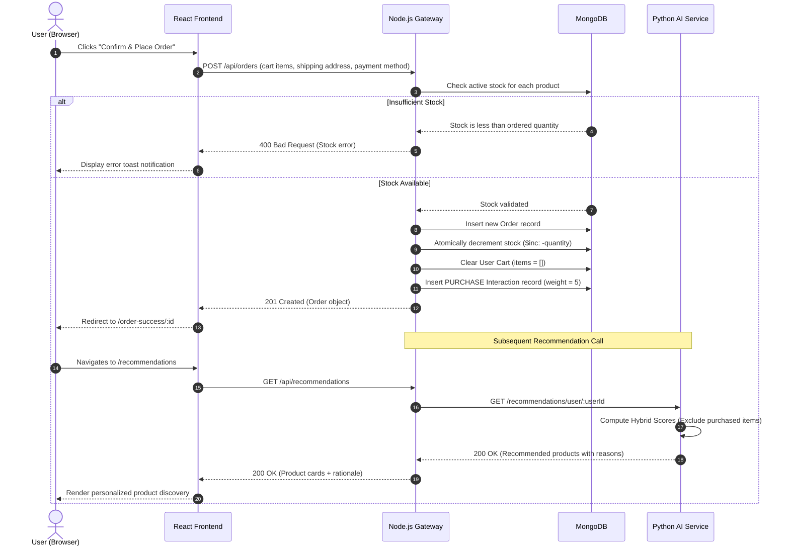
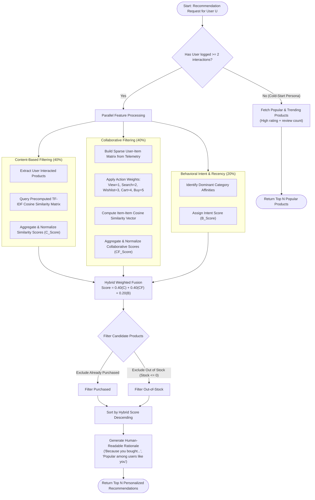
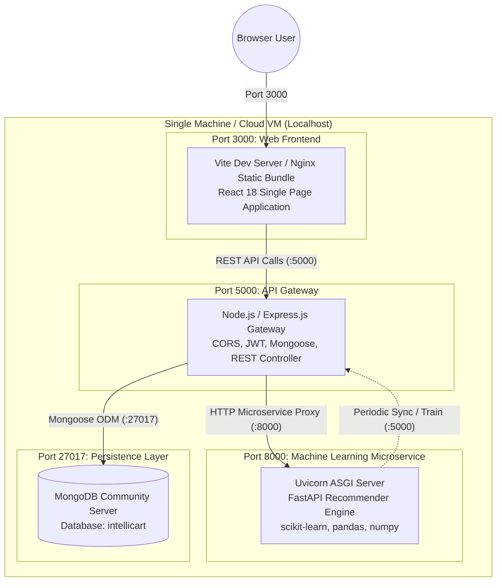

# IntelliCart - UML & Architecture Diagrams

This document contains standard Mermaid diagrams modeling the software engineering architecture, database design, user workflows, and machine learning pipelines of **IntelliCart**.

---

## 1. System Architecture Diagram

---

## 2. Use Case Diagram

---

## 3. Database Entity-Relationship Diagram (ERD)

---

## 4. Sequence Diagram: Order Placement & Behavioral Telemetry

---

## 5. Recommendation Engine Workflow Diagram

---

## 6. Deployment Architecture Diagram

